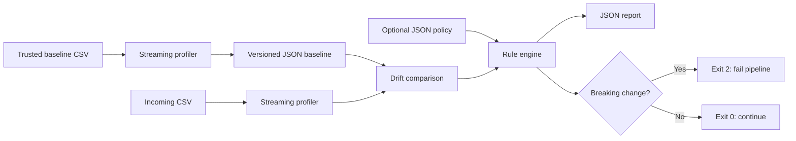

# 🛡️ Schema Drift Guard

[](https://github.com/nazirreally/schema-drift-guard/actions/workflows/tests.yml)


**Fail fast when incoming CSV feeds violate your data contract.** A streaming, dependency-free Python CLI that profiles source files, versions their observed schemas, detects incompatible changes, and applies explicit per-column policies.

> **Use case:** A nightly supplier feed silently changes `amount` from numeric to free text. Instead of corrupting downstream dashboards, a CI job reports the drift and exits with code 2.

## Architecture



## Stack and engineering highlights

| Layer | Implementation |
|---|---|
| Runtime | Python 3.10+ standard library only |
| Input | UTF-8 / UTF-8-BOM CSV |
| Profiling | Streaming `csv.DictReader`, bounded by `--sample-limit` |
| Contract | JSON schema snapshot and optional policy |
| Policy engine | Ordered, glob-based column matching via `fnmatch` |
| Verification | `unittest`, GitHub Actions Python version matrix |
| Integration | Exit codes and machine-readable JSON output |

## Quick start

```bash
git clone https://github.com/nazirreally/schema-drift-guard.git
cd schema-drift-guard
python -m pip install -e .
printf 'id,amount\n1,12.5\n' > baseline.csv
printf 'id,amount\n2,unknown\n' > incoming.csv
python -m driftguard snapshot baseline.csv --output schema.json
python -m driftguard check incoming.csv --baseline schema.json
# exit 2: amount changed from number to string
```

For Windows PowerShell, create the two sample files with `Set-Content` and run the same Python commands.

### Enforce a data contract

Create `policy.json`:

```json
{
  "required_columns": ["id", "amount"],
  "rules": [
    {"column": "metadata_*", "change": "added", "severity": "ignore"},
    {"column": "amount", "change": "type", "severity": "breaking"},
    {"column": "*", "change": "added", "severity": "informational"}
  ]
}
```

Then:

```bash
python -m driftguard check incoming.csv --baseline schema.json --policy policy.json
```

The policy supports:
- `required_columns`: columns that must appear in the incoming feed, even if absent from the original snapshot.
- `rules`: ordered rules with `column` glob, `change` category, and `severity`.
- Categories: `added`, `removed`, `type`, `new_null_values`.
- Severities: `breaking`, `informational`, `ignore`.
- **First matching rule wins.** Ignored findings are omitted from the JSON report. Required-column checks remain breaking unless a matching rule explicitly changes an applicable removal finding.

An example contract is included at [examples/policy.json](examples/policy.json).

### JSON result

```json
{
  "breaking": true,
  "changes": [
    {"column": "amount", "change": "type number -> string", "severity": "breaking"}
  ]
}
```

| Exit code | Meaning |
|---|---|
| 0 | No breaking findings |
| 1 | Invalid CSV, baseline, policy, or filesystem error |
| 2 | Breaking schema or contract violation |

## Standalone HTML audit reports

Generate a polished, offline-readable contract audit alongside the JSON output:

```bash
python -m driftguard check incoming.csv --baseline schema.json --policy policy.json --html-report audit.html
# Open audit.html in any browser. Exit 2 still indicates a breaking violation.
```

The HTML report includes an overall pass/fail status, breaking/informational counts, baseline and current column counts, a detailed change register, and sample sizes. It uses embedded CSS only: **no CDN, JavaScript, or external network requests**. CSV column names and change text are HTML-escaped to prevent untrusted feed headers from injecting markup. Policy-ignored findings remain excluded from the report, just as in JSON.

The CLI writes the HTML before returning the existing exit code: 0 for accepted, 2 for breaking changes, and 1 for errors. Filesystem errors when writing the report are treated as CLI errors rather than silently ignored.

## CI integration

Commit `schema.json` and `policy.json` with the pipeline. In your ingestion job:

```yaml
- name: Validate incoming feed
  run: python -m driftguard check data/incoming.csv --baseline schema.json --policy policy.json
```

This repository's own [test workflow](.github/workflows/tests.yml) exercises the unit tests across Python versions.

## Repository map

```text
src/driftguard/
  core.py        CSV profiling, comparison, JSON baseline\n  report.py      Portable, escaped HTML audit renderer
  policy.py      Ordered contract rules and required columns
  __main__.py    snapshot/check command-line interface
tests/
  test_core.py   Core profiling and CLI behavior\n  test_report.py HTML output, injection defense, CLI exit codes
  test_policy.py Policy parsing and rule precedence
  test_validation.py Defensive CSV and baseline validation
examples/
  policy.json    Example contract
.github/workflows/tests.yml
pyproject.toml
```

## Verification

The defensive input suite passed **5/5 tests locally** on 21 Nov 2026 in an isolated source harness. The [21 November 2026 GitHub Actions run](https://github.com/nazirreally/schema-drift-guard/actions/runs/44938307603) completed successfully. The workflow executes the full unittest suite across Python 3.10, 3.12 and 3.13; the badge shows the current workflow status.

Run the complete suite yourself with:

```bash
python -m unittest discover -s tests -v
```

## Design trade-offs

- **Streaming and bounded:** handles large files without holding all records in memory, but only the sampled rows influence type inference.
- **Conservative typing:** infers integer, number, string, and unknown; leading-zero IDs may be inferred as integers. Nonfinite numeric tokens (NaN, Infinity, overflowed exponent notation) are treated as strings, not valid numbers.
- **Defensive contracts:** rejects blank CSV header fields and malformed baseline snapshots (missing/invalid row counts, unknown types, impossible null counts) with a controlled CLI error rather than a traceback.
- **Schema vs semantics:** detects observed structural changes, not uniqueness, currency consistency, referential integrity, or source freshness.
- **Null semantics:** flags newly observed nulls in previously null-free columns; it does not compute statistical confidence.
- **Policy flexibility:** glob rules let teams tolerate harmless metadata changes, but broad ignore rules can conceal real regressions.
- **No external services:** useful in CI and local development, but not a hosted data observability service.

## Roadmap

- Versioned policy schema and richer validation errors
- Timestamp/date inference with explicit opt-in
- Historical trend comparisons and richer historical audit metadata
- Optional GitHub Action packaging

## License

[MIT](LICENSE)


### 2026-11-22 — HTML audit delivery

Implemented a self-contained HTML report renderer, `check --html-report` CLI integration, and five regression tests for escaping, report status, no-change state, filesystem output, and the breaking-change exit code. The renderer's four core tests passed in a local isolated harness before publication. The complete GitHub repository suite and the new end-to-end CLI test require CI confirmation; the existing badge reflects GitHub Actions rather than an assumed result.
